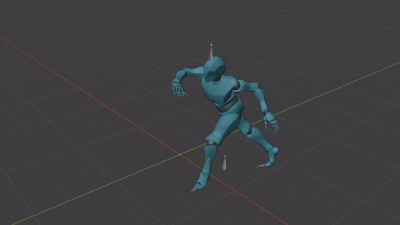
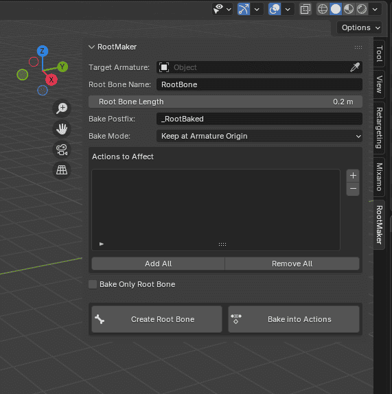
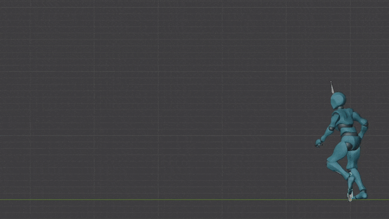
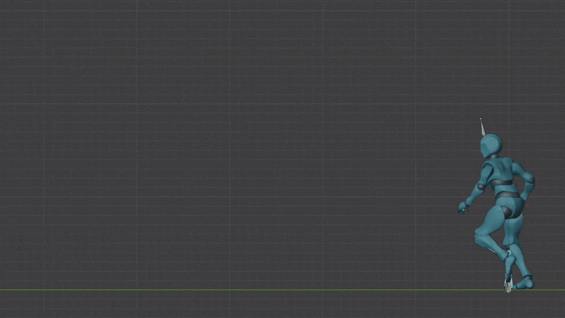

# 🦴 RootMaker

A simple addon to create a root bone and bake it into your already existing animations (or just bake if you already have a root bone)

> ***Don't want the entire addon just the code?***  
> Take a look inside `root_maker_utils.py` 

## 🛠️ How to install?

1. Download this repo as .zip file (you can delete `/images` folder)
2. Go to _Edit -> Preferences -> Add-ons -> Install from Disk_ and select the .zip file (make sure it's enabled once installed)
3. If it has been successfully installed you should see it on the side panel as such:
   

## 💡 How to use?

Here's what all the different properties do:

1. **Target Armature:** Select within it whichever armature you'd like to modify

2. **Root Bone Name:** By what name should the new root bone be created / Name of bone to use while baking into actions

3. **Root Bone Length:** Length of the root bone to that is to be created 

4. **Bake Postfix:** What postifx to give to the name of the newly baked action (Note: If empty then original action is overwritten)

5. **Bake Mode:**  
    a. **Keep at Armature Origin:** The root bone is fixed at the armature origin
       
    b. **Keep on Ground:** The root bone moves along with animation but always stays on ground 
       
    c. **Allow Offset in Air:** Allows root bone to move up into the air but always maintains the offset & doesn't allow going below ground (offset is the distance between `follow bone` and `root bone` in edit mode)
       

6. **Follow Bone:** Which bone should root bone follow when `Keep on Ground` or `Allow Offset in Air` is selected

7. **Actions to Affect:** This holds the list of actions you would like to bake (Use the +- buttons on the side to add/remove actions)

8. **Add All:** Adds all existing actions into "Actions to Affect" 

9. **Remove All:** Removes all actions from "Actions to Affect" 

10. **Bake Only Root Bone:** Bakes only the root bone into the action while leaving everything else unchanged
